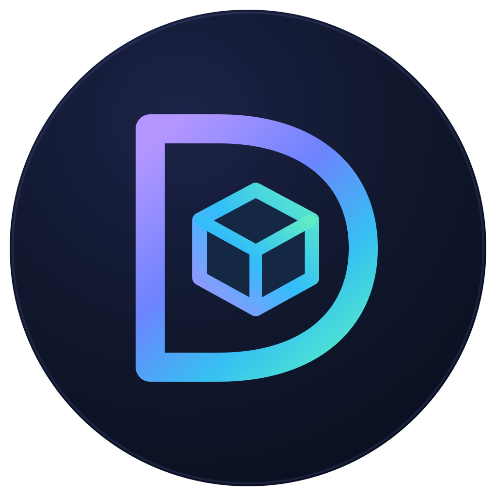

# Levencode Labs

**Thoughtful tools for working with code.**

Built with AI. Refined through engineering, testing, and review.

---

We build practical tools for developers and coding agents. The aim is simple: make complex code changes easier to understand, safer to carry out, and clearer to verify.

**Products:** [BlastRadius](#blastradius) · [Deploom](#deploom) · [SelfReview](#selfreview)

## BlastRadius

**See what a change touches. Find what becomes unreachable.**

BlastRadius gives developers and coding agents an evidence-backed map of a refactor's potential impact. Before a change, it traces static symbol consumers, React components, affected routes and related tests. After a change, it finds newly unreachable exports and broken references against a Git baseline.

- **Trace the impact.** Inspect file- and symbol-level dependencies, not just text matches.
- **Spot the leftovers.** Separate newly orphaned code from existing dead code and test/Storybook-only usage.
- **Keep uncertainty visible.** Public APIs, side effects and unresolved dynamic usage never become blanket permission to delete.

**[Repository](https://github.com/levencode-labs/blastradius)** · [Source preview](https://github.com/levencode-labs/blastradius/tree/development/initial-source) · [Architecture](https://github.com/levencode-labs/blastradius/blob/development/initial-source/docs/ARCHITECTURE.md)

Development preview (`0.0.1-dev`) — no `v0.1.0` release. CLI, MCP server and Agent Skill are under validation; npm publication and complete acceptance remain pending.

---

## Deploom

**Dependency upgrades with a clear plan.**

Deploom helps developers and coding agents plan dependency updates for JavaScript and TypeScript projects. It brings version choices, compatibility constraints, permitted changes, and unresolved evidence into one inspectable workflow.

- **Plan within boundaries.** Choose which dependencies may change and which version lines are acceptable.
- **Understand decisions.** See conflicts, blockers, and the reasons behind proposed versions.
- **Check the result.** Keep planning, installation, and runtime verification separate.

**[Get started](https://github.com/levencode-labs/deploom-mcp/blob/main/USERGUIDE.md)** · [Руководство на русском](https://github.com/levencode-labs/deploom-mcp/blob/main/USERGUIDE.ru.md) · [Latest release](https://github.com/levencode-labs/deploom-mcp/releases/latest)

### Projects

<table>
  <thead><tr><th align="left" width="200">Repository</th><th align="left">What it does</th></tr></thead>
  <tbody>
    <tr>
      <td><a href="https://github.com/levencode-labs/deploom-core">&nbsp;<strong>Deploom&nbsp;Core</strong></a></td>
      <td>Planning engine for dependency-version decisions, compatibility constraints, and explicit evidence.</td>
    </tr>
    <tr>
      <td><a href="https://github.com/levencode-labs/deploom-mcp">&nbsp;<strong>Deploom&nbsp;MCP</strong></a></td>
      <td>Agent-facing MCP server, structured upgrade plans, verification boundaries, and the optional <code>deploom-upgrade</code> Skill.</td>
    </tr>
    <tr>
      <td><a href="https://github.com/levencode-labs/deploom-npm">&nbsp;<strong>Deploom&nbsp;npm</strong></a></td>
      <td>Windows installer for the MCP server and Skill, with offline setup and a public cache of npm advisories and migration records.</td>
    </tr>
  </tbody>
</table>

Deploom is under active development. An upgrade plan is not an installed or runtime-verified migration; acceptance requires checks against the actual result.

---

## SelfReview

**Project conventions you can trace, approve, and check before code review.**

SelfReview is a local toolkit for JavaScript, TypeScript, and React/TSX. It turns project-specific review expectations into explicit, reusable checks: collect rule candidates from source code, agreements, and merge-request feedback; review and approve them; then apply supported rules through AST analysis, the CLI, and an ESLint adapter.

- **Respect project scopes.** Keep conventions separate for each codebase or share them across a team.
- **Approve deliberately.** Discovered patterns and review comments are rule candidates, not automatic policy.
- **Review before the review.** Check changed code and export conventions for agents and developers.

**[Get started](https://github.com/levencode-labs/selfreview/blob/main/USERGUIDE.md)** · [Руководство на русском](https://github.com/levencode-labs/selfreview/blob/main/USERGUIDE.ru.md) · [Repository](https://github.com/levencode-labs/selfreview)

SelfReview complements human code review. Unsupported or ambiguous conventions stay visible for manual review; AST checks do not replace project tests or runtime verification.
